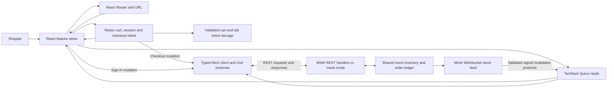

# Shopflow architecture

Shopflow is a React and TypeScript storefront. Vite serves the development app, Tailwind styles it, and MSW supplies a simulated REST API and stock feed in local mock mode and the public Pages demo. The Pages build uses hash routing under `/shopflow-react/`.

## Repository layout

| Path                                                                          | Responsibility                                                                                             |
| ----------------------------------------------------------------------------- | ---------------------------------------------------------------------------------------------------------- |
| [src/main.tsx](../src/main.tsx) and [src/App.tsx](../src/App.tsx)             | Start conditional mocks, install providers, route pages, and render the shared shell.                      |
| [src/app/](../src/app/)                                                       | Redux store, typed Redux hooks, render error boundary, and sanitized logging.                              |
| [src/api/](../src/api/)                                                       | Typed fetch client, Zod schemas, and validated WebSocket transport.                                        |
| [src/features/](../src/features/)                                             | Browse, cart, authentication, and order confirmation.                                                      |
| [src/hooks/](../src/hooks/)                                                   | Debounce, document title, scroll, and live stock hooks.                                                    |
| [src/components/ui/](../src/components/ui/) and [src/styles/](../src/styles/) | Shared UI classes, money formatting, and Tailwind theme.                                                   |
| [src/mocks/](../src/mocks/) and [public/](../public/)                         | Mock endpoints, catalog, tab order ledger, stock simulator, service worker asset, and product placeholder. |
| [src/test/](../src/test/) and [.github/workflows/](../.github/workflows/)     | Behavior tests, mock test setup, and PR checks.                                                            |
| [src/practice/](../src/practice/) and [docs/](./)                             | Preserved Week 1 exercises and project documentation.                                                      |

## Data flow

## State ownership

| Owner        | State and lifetime                                                                                                                                                                                                                               |
| ------------ | ------------------------------------------------------------------------------------------------------------------------------------------------------------------------------------------------------------------------------------------------ |
| Local UI     | Draft search, form errors, and image fallback state belong to the view that uses them.                                                                                                                                                           |
| URL          | Applied search, category, stock filter, sort and page belong in the address bar. Product and order IDs are route params. This supports links and Back/Forward.                                                                                   |
| Redux        | Cart IDs, quantities and display snapshots, the memory-only session, and checkout intent and submission status. Selectors derive cart count and total. A validated cart is stored locally, and pending checkout intent uses tab session storage. |
| Server cache | TanStack Query owns catalog responses, product details, account data and order status. Public catalog queries use a 30-second stale time. Account and order reads use session-scoped keys and are stale immediately.                             |
| Mock backend | The mock owns current stock, token validity and order records. REST and WebSocket handlers share inventory. The tab ledger protects accepted submissions against replay.                                                                         |

## Three patterns in use

| Pattern and location                                                                                                                                      | Why it is used                                                                                                                                                      | Trade-off                                                                                                                |
| --------------------------------------------------------------------------------------------------------------------------------------------------------- | ------------------------------------------------------------------------------------------------------------------------------------------------------------------- | ------------------------------------------------------------------------------------------------------------------------ |
| Transport adapter and boundary validation in [client.ts](../src/api/client.ts) and [schemas.ts](../src/api/schemas.ts)                                    | Routes use typed operations while one client parses unknown responses, maps errors, and forwards cancellation.                                                      | Schemas must stay aligned with the API. Validation adds some work at the boundary.                                       |
| Derived state with selectors in [store.ts](../src/app/store.ts) and [App.tsx](../src/App.tsx)                                                             | The header derives count and total from cart lines so edits have a single source of truth.                                                                          | Prices are display snapshots until product details refresh. The mock calculates order totals independently.              |
| Query-key isolation and invalidation in [browse-queries.ts](../src/features/browse/browse-queries.ts) and [useLiveStock.ts](../src/hooks/useLiveStock.ts) | Different effective filters get different keys. Cancellation and distinct keys prevent old results appearing under the new search. Stock changes trigger a refresh. | Refetching product queries can cost extra requests. It preserves filtered totals and page membership when stock changes. |

A walkthrough choice to defend is URL state for applied filters. It adds parsing and canonicalization but gives shoppers shareable, restorable views. The search draft stays local until it settles so the address bar records the last applied query. During an uncommitted edit, the results area shows an updating state.
