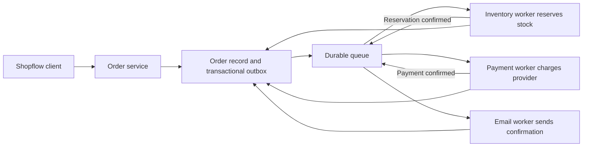

# Shopflow orders

## Implemented mock checkout

The client stores a pending order body and idempotency key in tab session storage before submitting. The mock checks the account and key first. An equivalent replay returns the original order ID, and a different body under the same key returns 400. A new order checks stock and records its reservation and queued result. Checkout updates the cart only after a validated 201 response. Network retries are manual and preserve the original body and key.

The guarantee applies to the same account and mock tab session. Reloading requires signing in again. The pending intent and mock ledger must survive the reload. Clearing either record or closing the tab can lose the retry guarantee. Order status advances on mock reads using elapsed time. [API contract](api-contract.md#checkout-retries) · [Store](../src/app/store.ts) · [Mock order handlers](../src/mocks/handlers.ts)

## Proposed production design

This diagram describes a future service. The current app simulates order status and stock reservations in MSW. Payment processing, workers, and a durable queue are proposed.

- The order service authenticates the customer and records the order, request fingerprint, and outbox message in one transaction. It can acknowledge a queued order quickly while workers take on slower work.
- Delivery may happen more than once. Each worker checks durable state and applies its step once per order. Transient failures retry with backoff. Exhausted jobs go to a dead-letter queue for investigation. A terminal payment failure releases the reservation through an idempotent compensating step.
- The payment worker uses a stable provider idempotency key per charge and stores the provider reference. When a payment reply is ambiguous, it checks the prior result or retries with the same key. It avoids starting a second charge with a fresh key for the same attempt.
- An email outage delays the confirmation email. The order and payment stay recorded, and the shopper can see the order in the app. The email worker retries independently, with a notification record to help suppress duplicates.
